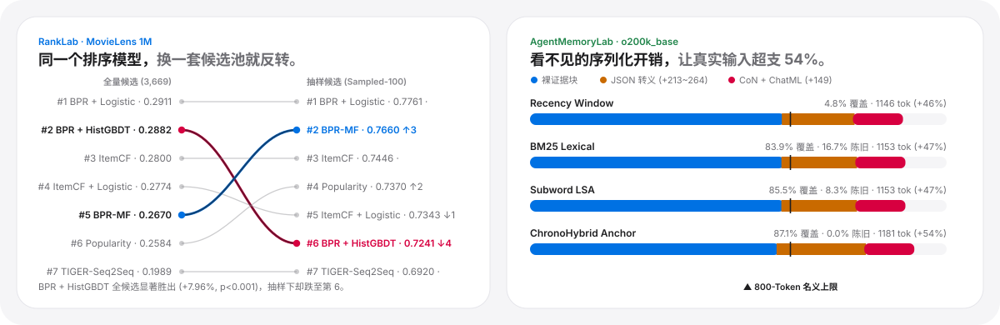

  <picture>
    <source media="(prefers-color-scheme: dark)" srcset="./hero-dark.svg">
    <source media="(prefers-color-scheme: light)" srcset="./hero-light.svg">
    
  </picture>

  <a href="https://zou-zhongyuan.github.io/"><strong>交互式工程博客 ↗</strong></a> &nbsp;·&nbsp;
  <a href="https://zou-zhongyuan.github.io/#article-rank-inversion"><strong>RankLab 案例研究</strong></a> &nbsp;·&nbsp;
  <a href="https://github.com/Zou-Zhongyuan/campus-checkout-workflow"><strong>Campus Checkout 源码 ↗</strong></a> &nbsp;·&nbsp;
  <a href="https://zou-zhongyuan.github.io/#projects">全部项目</a> &nbsp;·&nbsp;
  <a href="https://zou-zhongyuan.github.io/#writing">技术笔记</a>

  <picture>
    <source media="(prefers-color-scheme: dark)" srcset="./telemetry-dark.svg">
    <source media="(prefers-color-scheme: light)" srcset="./telemetry-light.svg">
    
  </picture>

### Featured · 重点推荐

1. **[RankLab — 推荐系统离线评测与生成式检索](https://zou-zhongyuan.github.io/#ranklab)** · [完整案例研究](https://zou-zhongyuan.github.io/#article-rank-inversion) · [项目详情](https://zou-zhongyuan.github.io/#ranklab-spec)
   在 GroupLens 官方 MovieLens Latest Small（`100,836` 条交互，`96` 名测试用户）与 MovieLens 1M（`1,000,209` 条交互，`1,486` 名测试用户）上，采用 70%/15%/15% 嵌套全局时间切分与 `3` 随机种子（`[42, 1024, 2026]`）对比全量候选（`3,669` / `8,187` 部）与 `Sampled-100` 抽样候选协议（全部可用未见正例 + 至多 99 个负例，按 `M = 100` 截取）。在 `ml-1m` 上，`BPR-MF + HistGBDTRerank` 全候选显著高于 `BPR-MF`（`0.28819` vs `0.26695`，`+7.96%`，`B=2,000` Bootstrap `p < 0.001`），切换抽样后却反输（`0.72407` vs `0.76598`，`-5.47%`）；`10,402` 份推荐列表零已看泄漏，`TIGER-Seq2Seq` 受控前缀树解码 `5,017,998` 束实现 `0` 非法物品幻觉。
2. **[Campus Checkout — 正交订单与支付结算状态机](https://github.com/Zou-Zhongyuan/campus-checkout-workflow)**（公开源码仓库） · [项目详情](https://zou-zhongyuan.github.io/#campus-checkout) · [状态机笔记](https://zou-zhongyuan.github.io/#article-payment-acceptance)
   源自校园外卖系统 UML 结账与配送时序设计，使用 Python 标准库零依赖实现订单履约状态（`OrderStatus`）与资金结算状态（`PaymentStatus`）正交解耦。已通过 `16/16` 单元测试，覆盖付款前取消、商家拒单退款、同 `event_id` 幂等重放、异载荷冲突拦截及先达拒单后补付款的乱序对账。

### Project Index · 全部项目

> 仅 [Campus Checkout](https://github.com/Zou-Zhongyuan/campus-checkout-workflow) 为公开源码仓库，其余项目均链接至个人博客中的方法、可核验产物与实验边界说明。

| 项目 | 核心机制 | 已核验离线结论 | 入口 |
| :--- | :--- | :--- | :--- |
| **[RankLab](https://zou-zhongyuan.github.io/#ranklab-spec)** | 嵌套全局时间切分 · `ItemCF` / `BPR-MF` / `TIGER-Seq2Seq` 受控前缀树 · 两阶段重排 | 官方 `ml-1m`（`1,486` 用户）全候选重排提升 **`+9.05%`**（`0.29110`，`p < 0.001`），复现抽样候选名次反转；`5,017,998` 束零非法幻觉，`MPS→CPU` 提速 **575×**；`8/8` 防泄漏单测通过 | [博客详情](https://zou-zhongyuan.github.io/#ranklab-spec) · [案例研究](https://zou-zhongyuan.github.io/#article-rank-inversion) |
| **[Campus Checkout](https://github.com/Zou-Zhongyuan/campus-checkout-workflow)** | 订单履约与支付结算正交双状态机（BCE） · 幂等重放吸收 · 乱序回调恢复 | 独立公开源码仓库 · Python 标准库实现，`16/16` 单元测试覆盖取消、拒单退款与重复回调冲突 | [公开仓库 ↗](https://github.com/Zou-Zhongyuan/campus-checkout-workflow) · [博客详情](https://zou-zhongyuan.github.io/#campus-checkout) |
| **[AgentMemoryLab](https://zou-zhongyuan.github.io/#agentmemorylab)** | `o200k_base` 四层预算核算 · `ChronoHybridAnchor` 检索 · `OPAQUE_PUBLIC_IDS_V2` | 量化 JSON 转义与 ChatML 框架带来的 **`+46%~+54%`** 隐性超支；陈旧记忆覆写率降至 **`0.0%`**；在官方 `LongMemEval_S`（数据集规模 500 题）前 60 题 `2,913` 个会话 tokenizer 对照中捕获最高 **`4.14×`** BPE 漂移；`11/11` 单测通过 | [博客详情](https://zou-zhongyuan.github.io/#agentmemorylab) |
| **[ToolForge](https://zou-zhongyuan.github.io/#toolforge)** | 多轮有状态工具沙箱 · 8 类失败归因 · `4096` 上下文硬护栏 · `MLX` / `HF` 双后端 | `1,980` 轮轨迹重放 `0.0000` 漂移；`120` 道受控组合题参考策略 `120/120`、空动作反例 `0/120`；`60` 份冻结产物 SHA-256 零改动；`16/16` 单测通过（真实 LLM 待跑） | [博客详情](https://zou-zhongyuan.github.io/#toolforge) |
| **[ForgePilot](https://zou-zhongyuan.github.io/#forgepilot)** | 40-Hex Commit SHA **CAS** 人工审批门禁 · `WorkspacePathGuard` · 确定性预算熔断 | `20/20` 本地后端防御单测 + `Vite 8` 构建 + `Uvicorn` SSE 闭环（**mock 模拟工作流**）；保留跨模块任务在 `max_llm_calls=20` 下的 mock 模拟预算熔断轨迹（Docker / 实时 API 标 `NOT_EXECUTED`） | [博客详情](https://zou-zhongyuan.github.io/#forgepilot) |
| **[SE Agent SLR](https://zou-zhongyuan.github.io/#agent-review)** | PRISMA 2020 账本守恒 · 一手 arXiv HTML 精读与数学勘误 · LaTeX AST 静态校验 | `139 → 64 → 21` 篇纳入（未投稿研究草稿）；精读 `SWE-OPD` 定位截断 Top-K RKL 支撑集逃逸机理及 2 处表文数值差异 | [博客详情](https://zou-zhongyuan.github.io/#agent-review) |
| **[Frontier Systems Telemetry](https://zou-zhongyuan.github.io/#career-research)** | 六大工业界前沿架构与开源仓库 HTTP 探活映射（SHA-256 日期快照） | `103/103` 一手论文与开源仓库链接探活可达，串联 `DAPO/verl`、`GSPO/ROLL`、`LongMemEval`、`TencentGR` 与本地实验原型 | [博客详情](https://zou-zhongyuan.github.io/#career-research) |

### Writing · 技术笔记

- **[RankLab 案例研究：全候选与抽样候选为什么会让推荐模型排名反转？](https://zou-zhongyuan.github.io/#article-rank-inversion)** — 含 MovieLens 1M / Latest Small 数据集、70/15/15 全局时间拆分、全表 NDCG@10、Bootstrap 检验与实验局限
- **[支付成功之后，订单为什么还要等商家接单？](https://zou-zhongyuan.github.io/#article-payment-acceptance)** — 用 BCE 正交状态机推导支付回调、拒单退款与乱序事件对账
- **[用 49、50、51 检查边界条件](https://zou-zhongyuan.github.io/#article-bva-49-50-51)** — 三点边界值分析与 Python 严格类型断言
