  <picture>
    <source media="(prefers-color-scheme: dark)" srcset="./hero-dark.svg">
    <source media="(prefers-color-scheme: light)" srcset="./hero-light.svg">
    
  </picture>

Software Engineering · Xiamen University Malaysia

我关注推荐系统离线评测和后端工作流。作品档案记录了各项目的可检查产物、实验范围和当前进度。

[作品档案](https://zou-zhongyuan.github.io/projects.html) · [交互实验台](https://zou-zhongyuan.github.io/) · [技术笔记](https://zou-zhongyuan.github.io/#writing)

## 精选作品

| 项目 | 值得看的问题 | 入口 |
| --- | --- | --- |
| **RankLab** | 同一套重排模型在 MovieLens 1M 全候选评测中胜出，切换到抽样候选后落后。案例给出了拆分、候选池和逐用户汇总方法。 | [案例研究](https://zou-zhongyuan.github.io/#article-rank-inversion) · [交互图表](https://zou-zhongyuan.github.io/#ranklab) |
| **Campus Checkout** | 把订单履约和支付结算分开，处理重复回调、错序和拒单退款。Python 标准库示例附 16 项单元测试。 | [公开源码](https://github.com/Zou-Zhongyuan/campus-checkout-workflow) · [设计笔记](https://zou-zhongyuan.github.io/#article-payment-acceptance) |

## 工程原型与研究

- [AgentMemoryLab](https://zou-zhongyuan.github.io/projects.html#memory) — 检索对比与 tokenizer 预算核算。
- [ForgePilot](https://zou-zhongyuan.github.io/projects.html#workflow) — 模拟工作流、人工审批与预算控制。
- [ToolForge](https://zou-zhongyuan.github.io/projects.html#tools) — 有状态工具调用任务和评分协议。
- [研究记录](https://zou-zhongyuan.github.io/projects.html#research) — 软件工程智能体综述草稿和技术调研快照。

项目使用 Antigravity 等 AI 工具辅助。各案例注明实验与验证范围。
